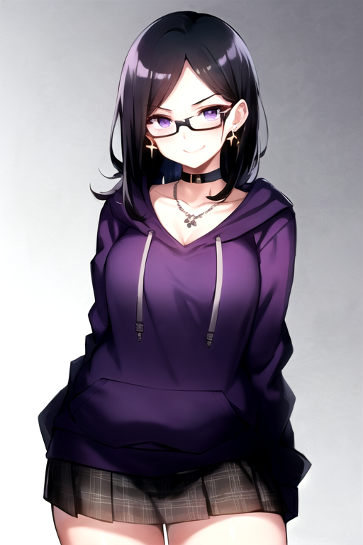

[README_Project_Anima.md](https://github.com/user-attachments/files/34671718/README_Project_Anima.md)
# Project Anima --- Clara

<div align="center">
  
</div>

> **Project Anima** is an experimental desktop AI companion built around
> **Clara**, a customizable 3D character. It combines a local Python
> conversational-AI backend with a Unity application for avatar
> presentation, interaction, and a desktop-companion-style interface.

**Status:** Active development · Early prototype\
**Primary platform:** Windows 11\
**Current focus:** Unity UI foundation and avatar presentation

------------------------------------------------------------------------

## Character preview

<div align="center">
  
</div>

*Character concept artwork generated during development. The
in-application character is a separate 3D VRM avatar.*

------------------------------------------------------------------------

## Project goals

Project Anima aims to create a personal AI companion that:

-   Supports natural text conversations with Clara.
-   Can eventually listen to spoken input and respond with generated
    speech.
-   Presents Clara as a 3D character inside a polished, avatar-first
    desktop interface.
-   Supports character expressions, idle animations, and
    audio-synchronized lip movement.
-   Keeps the core AI services local.
-   Can eventually be shared as a source project with setup
    instructions. Standalone packaging is a later consideration.

The intended experience is closer to an interactive desktop character
than a conventional chatbot window. Clara should remain the visual
centrepiece, while chat and utility panels can be opened, moved, and
collapsed.

------------------------------------------------------------------------

## Architecture overview

<div align="center">
  
</div>

The project is split into two main parts:

1.  **Python backend** --- conversation generation, conversation
    storage, speech recognition, and text-to-speech.
2.  **Unity frontend** --- Clara's 3D avatar, visual presentation,
    interface, input controls, and audio playback.

The planned connection is a local HTTP API using JSON. Unity will send a
user's message to the Python backend and receive Clara's response and
optional metadata.

``` text
                 PROJECT ANIMA
                       |
          +------------+------------+
          |                         |
     UNITY FRONTEND            PYTHON BACKEND
          |                         |
   - Clara VRM avatar         - LangChain
   - Desktop-style UI         - Ollama / Qwen3
   - Camera and presets       - SQLite history
   - Chat controls            - Speech recognition
   - Audio playback           - Text-to-speech
   - Expressions              - Local API (planned)
          |                         |
          +------ Local HTTP -------+
                    (planned)
```

The local API layer is a planned integration step; the current Python
prototype has also been used through a command-line workflow.

------------------------------------------------------------------------

## Technology and tools

<div align="center">
  
</div>

The following list distinguishes tools already used from components that
are planned or experimental. Versions are included only where known.

### Python backend

``` text
  -----------------------------------------------------------------------
  Tool / technology       Purpose                 Status
  ----------------------- ----------------------- -----------------------
  **Python**              Main backend            In use
                          programming language.   

  **LangChain**           Organizes the LLM       In use
                          conversation flow and   
                          message context.        

  **Ollama**              Runs the language model In use
                          locally.                

  **Qwen3 8B (GGUF)**     Current local           In use
                          conversational model    
                          used through Ollama.    

  **SQLite**              Stores persistent       In use
                          conversation history    
                          locally.                

  **faster-whisper**      Speech-to-text          Integrated / available
                          transcription.          in the Python project

  **Whisper**             Speech-recognition      In use through
                          model family used       faster-whisper
                          through faster-whisper. 

  **PyAudio**             Microphone/audio input  Used in the Python
                          handling.               voice-input workflow

  **Kokoro TTS**          Generates spoken        Current TTS approach
                          responses from Clara's  
                          text.                   

  **FastAPI**             Intended local HTTP API Planned
                          between Python and      
                          Unity.                  
  -----------------------------------------------------------------------
```

Python modules have included:

-   `main.py` --- conversation/application entry point.
-   `database.py` --- SQLite conversation persistence.
-   `speech_to_text.py` --- microphone capture and transcription
    workflow.
-   `tts_client.py` --- client for the local Kokoro text-to-speech
    service.

File names and responsibilities may change as the backend is refactored
for Unity integration.

### Unity frontend

``` text
  -----------------------------------------------------------------------
  Tool / technology       Purpose                 Status
  ----------------------- ----------------------- -----------------------
  **Unity 2022.3.18f1     Main application and 3D In use
  LTS**                   presentation            
                          environment.            

  **C#**                  Unity scripts and       In use
                          frontend behaviour.     

  **UniVRM**              Imports and supports    In use
                          VRM avatars in Unity.   

  **VRM 1.0**             Avatar format used by   In use
                          Clara's imported 3D     
                          model.                  

  **Unity UI (uGUI /      Sidebar, chat window,   In use
  Canvas)**               buttons, and interface  
                          layout.                 

  **TextMeshPro**         UI text and message     In use
                          input.                  

  **Render Texture +      Planned isolated        Planned
  RawImage**              avatar-camera           
                          presentation inside the 
                          UI.                     

  **Unity Event System**  UI interaction, button  In use
                          events, and             
                          pointer/drag handling.  
  -----------------------------------------------------------------------
```

### Character art and visual development

``` text
  -----------------------------------------------------------------------
  Tool / technology       Purpose                 Status
  ----------------------- ----------------------- -----------------------
  **Stable Diffusion**    Character concept and   Used
                          visual exploration.     

  **AUTOMATIC1111 Stable  Local interface used    Used
  Diffusion WebUI**       for image generation.   

  **Abyss Orange Mix**    Checkpoint used during  Used
                          Clara's character-art   
                          exploration.            
  -----------------------------------------------------------------------
```

The generated character artwork is a visual reference for Clara. The
in-application character is a separate 3D VRM avatar.

### Development tools

``` text
  -----------------------------------------------------------------------
  Tool                                Purpose
  ----------------------------------- -----------------------------------
  **Visual Studio Code**              Editing Python and C# project
                                      files.

  **Git**                             Source control and version
                                      tracking.

  **GitHub**                          Intended home for the source
                                      repository and project
                                      documentation.

  **Windows 11**                      Primary development environment.
  -----------------------------------------------------------------------
```

------------------------------------------------------------------------

## Current Unity application roadmap

<div align="center">
  
</div>

The Unity application is being developed as a desktop-style companion
interface. The initial target is a functional project running in the
Unity Editor; a standalone executable or installer can come later.

### 1. UI foundation

-   [x] Create the Unity Canvas and initial UI hierarchy.
-   [x] Create the right-side tool sidebar.
-   [x] Add sidebar buttons for chat, listening, view, background, and
    options.
-   [x] Establish the dark minimalist visual style.
-   [x] Create the chat window and header.
-   [x] Add a scrollable conversation area.
-   [x] Create sample user and Clara message bubbles.
-   [x] Add the message input field and send button visually.
-   [x] Make the chat window draggable.
-   [x] Make the chat window collapsible and reopenable through the
    sidebar.
-   [ ] Connect the chat UI to the Python conversation backend.
-   [ ] Dynamically create message bubbles from actual conversation
    messages.
-   [ ] Automatically scroll to the latest message.
-   [ ] Preserve the chat window's last position when hidden and
    reopened.

### 2. Avatar presentation

-   [ ] Set up a dedicated avatar camera and Render Texture.
-   [ ] Display the Render Texture through a Unity UI RawImage.
-   [ ] Separate the background from the avatar camera so camera
    movement does not move the background.
-   [ ] Create a camera pivot/target around Clara.
-   [ ] Implement camera rotation and zoom controls.
-   [ ] Add camera framing presets:
    -   [ ] Face
    -   [ ] Upper body
    -   [ ] Lower body
    -   [ ] Full body

### 3. Listening mode

-   [ ] Create the listening-mode panel.
-   [ ] Implement push-to-talk using Unity microphone input.
-   [ ] Send recorded audio to the Python backend.
-   [ ] Transcribe speech using faster-whisper.
-   [ ] Add a visible recording indicator and microphone mute/disable
    control.
-   [ ] Explore active listening with voice activity detection (VAD) as
    a later feature.

### 4. Background selector

-   [ ] Create a background gallery accessible from the sidebar.
-   [ ] Display image thumbnails and filenames.
-   [ ] Allow the user to add their own background images.
-   [ ] Support PNG and JPG images initially.
-   [ ] Indicate the currently selected background.
-   [ ] Save and restore the selected background.

### 5. Character animation and expressions

-   [ ] Add an idle animation (subtle movement, breathing, and
    blinking).
-   [ ] Implement audio-synchronized mouth movement.
-   [ ] Explore VRM facial expressions.
-   [ ] Connect conversational emotion metadata to avatar expressions.
-   [ ] Explore more detailed lip-sync using visemes or phoneme timing.

### 6. Facecam / compact mode

-   [ ] Create a compact view focused on Clara's face and upper body.
-   [ ] Reduce or hide the main interface while in compact mode.
-   [ ] Provide a way to reveal the sidebar and controls.
-   [ ] Explore window resizing, always-on-top behaviour, and desktop
    integration later.

### 7. Options and customization

-   [ ] Add an options/settings page.
-   [ ] Add audio input and output device settings.
-   [ ] Add sound and voice settings.
-   [ ] Investigate clothing customization based on Clara's VRM model
    structure.
-   [ ] Add other user preferences as the application develops.

### 8. Backend integration and distribution

-   [ ] Wrap the existing Python conversation workflow in a local
    FastAPI service.
-   [ ] Define a stable JSON request/response format between Unity and
    Python.
-   [ ] Return response text and optional emotion/animation metadata.
-   [ ] Make generated audio accessible to Unity for playback and
    lip-sync.
-   [ ] Connect Unity chat input and output to the backend.
-   [ ] Improve startup/shutdown handling for local services.
-   [ ] Document installation and setup.
-   [ ] Consider standalone Windows packaging.

------------------------------------------------------------------------

## Planned Python ↔ Unity communication

<div align="center">
  
</div>

The intended integration uses a local API. This is a design direction,
not a claim that the API is already implemented.

A simplified request could look like:

``` json
{
  "message": "Hey Clara, how are you?"
}
```

A simplified response could look like:

``` json
{
  "text": "I'm doing alright. It's nice to hear from you.",
  "emotion": "relaxed",
  "intensity": 0.4,
  "animation": "subtle_head_turn"
}
```

Unity would use the returned text to update the conversation panel,
emotion metadata to select a supported avatar expression, and optional
audio data from the backend to play Clara's spoken response.

The final API format, error handling, and audio-delivery method still
need to be designed.

------------------------------------------------------------------------

## Suggested repository structure

The exact layout may change as the project grows. This is a suggested
organization, not a claim that the current local folders already match
it.

``` text
Project-Anima/
│
├── README.md
├── .gitignore
│
├── Python/
│   ├── main.py
│   ├── database.py
│   ├── speech_to_text.py
│   ├── tts_client.py
│   └── ...
│
├── Unity/
│   └── ClaraApplication/
│       ├── Assets/
│       ├── Packages/
│       └── ProjectSettings/
│
├── docs/
│   └── images/
│       └── clara-character.png
│
└── ...
```

------------------------------------------------------------------------

## Development notes

-   The Python backend and Unity frontend are being developed separately
    before their API integration.
-   SQLite is intended to remain the local persistent
    conversation-history store.
-   Unity will own avatar presentation, UI, and response-audio playback
    so that mouth movement can be synchronized with audio.
-   Push-to-talk is the first planned microphone interaction. Active
    listening is a later feature and should use voice activity detection
    rather than continuously submitting unsegmented audio.
-   The avatar camera is intended to render independently from the
    background and the rest of the UI.
-   The project is experimental and under active development. Roadmap
    items are not necessarily implemented yet.

------------------------------------------------------------------------

## Setup notes

This repository is still being organized. Setup instructions should be
completed and tested before being treated as a reliable installation
guide.

### Prerequisites

-   Windows 11
-   Python (use the backend's finalized environment version)
-   Unity Hub and Unity **2022.3.18f1 LTS**
-   Git
-   Ollama, with the required local model downloaded
-   Additional Python audio dependencies required by the selected
    microphone and TTS workflow

### Important setup considerations

-   Do not commit `.venv` or other virtual-environment folders.
-   Do not commit API keys, passwords, private configuration files, or
    personal data.
-   Do not commit generated databases containing private conversations.
-   Large model files and generated audio should generally be kept
    outside source control.
-   Check the licenses and redistribution terms for models, checkpoints,
    packages, and generated assets before distributing them.

------------------------------------------------------------------------

## Project status

Project Anima is a personal experimental project under active
development. Current work is focused on building the Unity desktop
interface and avatar presentation, while retaining the existing Python
AI prototype as the foundation for future integration.

**The long-term goal is a locally runnable, character-focused AI
companion that users can interact with through text and voice.**
